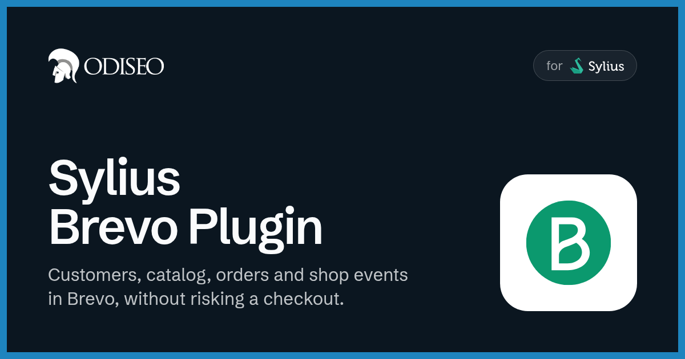
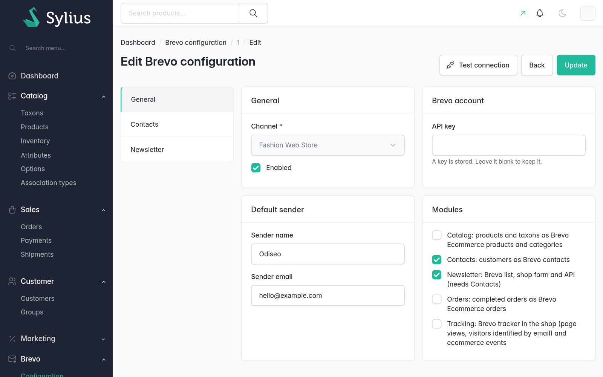
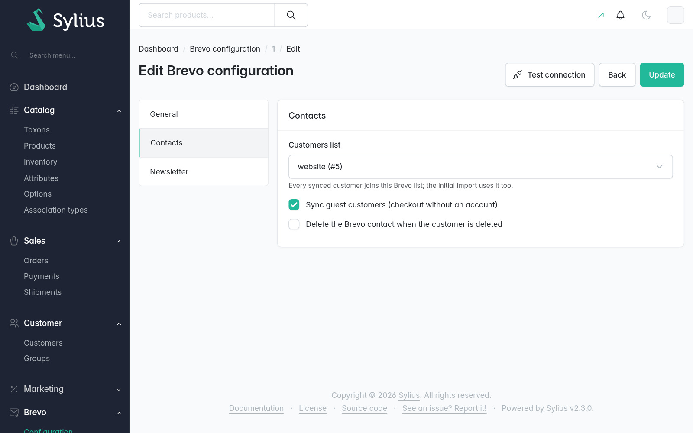
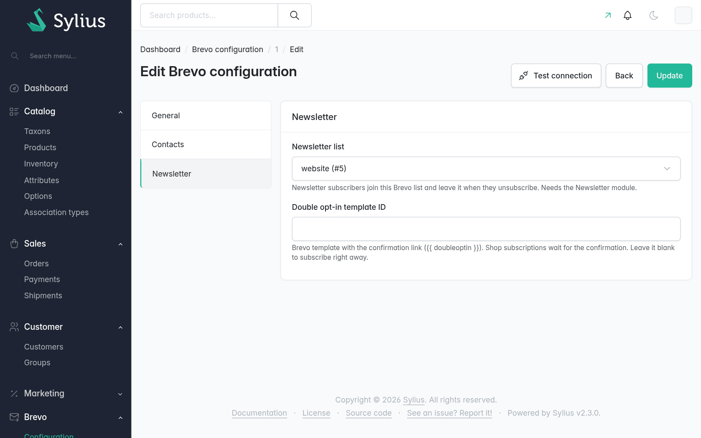
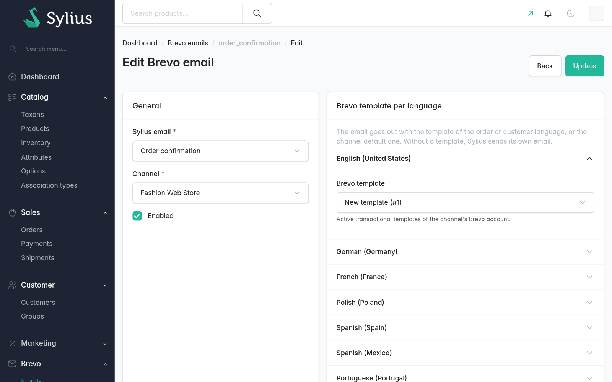
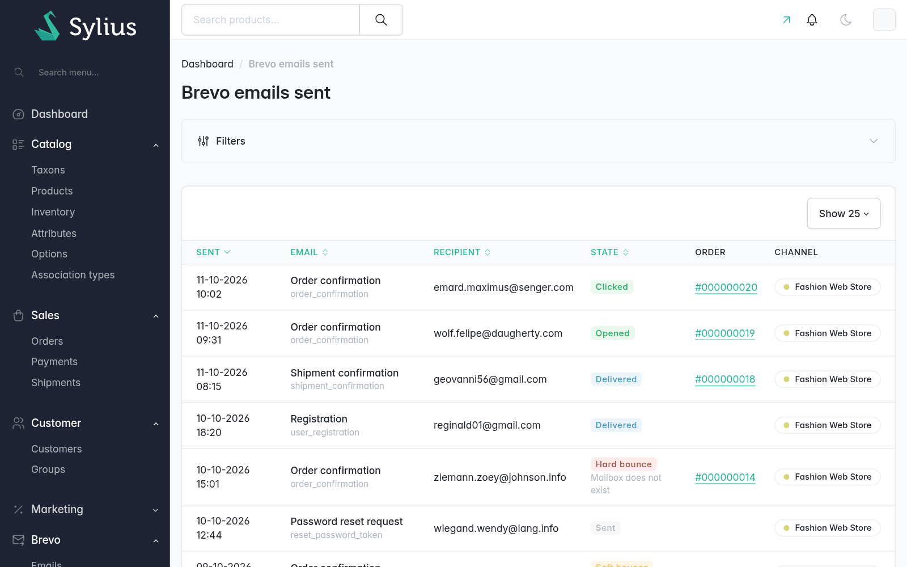

<p align="center">
    <a href="https://odiseo.io/en/products/sylius-brevo-plugin?utm_source=github&utm_medium=readme&utm_campaign=sylius-brevo-plugin" target="_blank">
        
    </a>
</p>
<p align="center">
    <a href="https://packagist.org/packages/odiseoteam/sylius-brevo-plugin"></a>
    <a href="https://packagist.org/packages/odiseoteam/sylius-brevo-plugin"></a>
    <a href="https://github.com/odiseoteam/sylius-brevo-plugin/actions/workflows/build.yaml"></a>
    
    
    <a href="LICENSE"></a>
</p>

## Introduction

This plugin connects each Sylius channel to a Brevo account and keeps both in sync: customers,
newsletter, catalog, orders and shop events, so marketing works in Brevo with the store's real data.

### What makes this plugin different?

- ✅ **Per channel** - Dedicated or shared Brevo accounts and settings per channel
- ✅ **Reliable background sync** - Symfony Messenger prevents Brevo failures from affecting requests or checkout
- ✅ **Contact sync** - Customers, guests, addresses and order stats kept up to date
- ✅ **Newsletter** - Double opt-in, cacheable subscription form and headless API support
- ✅ **Ecommerce sync** - Taxons, variants and orders, synced on change with currency conversion
- ✅ **Tracking and events** - Consent-based visitor tracking and events for marketing automations
- ✅ **Built to extend** - Customizable providers, decorators and Twig hooks
- ✅ **Broad compatibility** - Sylius 2.0–2.3, Symfony 6.4/7.4, PHP 8.2–8.4, MySQL and PostgreSQL

<details open>
<summary>
 Screenshots
</summary> <br />

<p align="center">
    <a href="https://docs.brevo.odiseo.io/getting-started/first-channel">
        
    </a>
</p>

<table>
    <tr>
        <td width="50%" align="center">
            <a href="https://docs.brevo.odiseo.io/features/contacts"></a>
            <br /><sub><b>Contacts:</b> Customers, guests and their Brevo list</sub>
        </td>
        <td width="50%" align="center">
            <a href="https://docs.brevo.odiseo.io/features/newsletter"></a>
            <br /><sub><b>Newsletter:</b> A Brevo list, with double opt-in</sub>
        </td>
    </tr>
    <tr>
        <td width="50%" align="center">
            <a href="https://docs.brevo.odiseo.io/pro/transactional-emails"></a>
            <br /><sub><b>Pro, emails:</b> Sylius emails with Brevo templates, per language</sub>
        </td>
        <td width="50%" align="center">
            <a href="https://docs.brevo.odiseo.io/pro/sent-emails"></a>
            <br /><sub><b>Pro, sent emails:</b> Every email with its delivery status</sub>
        </td>
    </tr>
</table>

</details>

## Getting Started

### Install it in 4 steps ⚡

1. ✅ Require the plugin (the Flex recipe registers it)
2. ✅ Run the migrations
3. ✅ Add a Brevo configuration to your channel, with its API key
4. ✅ Turn on the modules you need

**[👉 Follow the installation guide](https://docs.brevo.odiseo.io/getting-started/installation)**

### Quick Example

```bash
composer require odiseoteam/sylius-brevo-plugin
bin/console doctrine:migrations:migrate
```

Then go to **Brevo > Configuration** in the admin, add the channel's API key, turn on its modules and
send what the store already has:

```bash
bin/console odiseo:brevo:sync
```

> [!IMPORTANT]
> By default Brevo calls run right after each response, in the same PHP process. In production, set
> `ODISEO_BREVO_MESSENGER_TRANSPORT_DSN` to an async transport and run `bin/console messenger:consume odiseo_brevo`.

## Modules

Each feature is a module, turned on per channel:

| Module | What reaches Brevo |
| --- | --- |
| **Contacts** | Customers and guests as contacts, with names, phone, address, group and order stats |
| **Newsletter** | Subscribers in the channel's list, from the shop form, the account, the admin or the API |
| **Catalog** | Taxons as categories and product variants as products, with price, stock and image |
| **Orders** | Completed orders, with their status, products and totals |
| **Tracking** | The Brevo tracker, page views, identified visitors and the shop events |

**[Learn more about each module →](https://docs.brevo.odiseo.io/features/contacts)**

## Brevo Pro

**Brevo Pro** is the paid add-on that builds on this plugin. It concentrates the features where a bug
costs sales, with screens for the marketing team:

- ✉️ **Transactional emails** - Sylius emails designed in the Brevo editor, per language, with previews, test sends and Twig as fallback
- 📬 **Sent emails** - Every email with its delivery status, blocked addresses and one-click unblocking
- 🛒 **Cart and payment recovery** - Signed links that bring back a guest's cart, and payment links for unpaid orders, with UTM
- 📦 **More events** - Order awaiting payment, shipped, cancelled and refunded, and product reviews
- 🔁 **Webhooks** - Unsubscriptions made in Brevo back in Sylius
- 🗂️ **Past orders** - The order history imported into Brevo Ecommerce
- ⚙️ **Admin settings** - Contact attributes and events per channel, without YAML

One price, perpetual license, every Pro module included.

**[👉 Compare Free and Pro](https://docs.brevo.odiseo.io/pro/)** · **[Get Brevo Pro](https://odiseo.io/en/products/sylius-brevo-plugin?utm_source=github&utm_medium=readme&utm_campaign=sylius-brevo-plugin)**

## Documentation

The full documentation lives at **[docs.brevo.odiseo.io](https://docs.brevo.odiseo.io)**:

- 📦 **[Installation](https://docs.brevo.odiseo.io/getting-started/installation)** - With the Flex recipe, or step by step
- 🏁 **[Your first channel](https://docs.brevo.odiseo.io/getting-started/first-channel)** - API key, modules and the initial sync
- 👥 **[Contacts](https://docs.brevo.odiseo.io/features/contacts)** and **[Newsletter](https://docs.brevo.odiseo.io/features/newsletter)** - Attributes, lists, the shop form and double opt-in
- 🛍️ **[Catalog](https://docs.brevo.odiseo.io/features/catalog)** and **[Orders](https://docs.brevo.odiseo.io/features/orders)** - What Brevo Ecommerce gets, and when
- 📈 **[Tracking](https://docs.brevo.odiseo.io/features/tracking)** and **[Events](https://docs.brevo.odiseo.io/features/events)** - The tracker, consent and every event with its properties
- ⚙️ **[Configuration reference](https://docs.brevo.odiseo.io/configuration/reference)** - Every key under `odiseo_sylius_brevo`
- 🧩 **[Extending](https://docs.brevo.odiseo.io/extending/)** - Providers, decorators and hooks
- 💻 **[Console commands](https://docs.brevo.odiseo.io/operations/console)** - `debug`, `sync` and each module's sync
- 🚑 **[Troubleshooting](https://docs.brevo.odiseo.io/operations/troubleshooting)** - Nothing reaching Brevo, missing attributes, wrong currency
- 🤝 **[Contributing](CONTRIBUTING.md)** - Running the test application and the suites

## Compatibility

| Plugin | Sylius | PHP | Symfony | Database |
| ------ | ------ | --- | ------- | -------- |
| `^1.0` | 2.0 · 2.1 · 2.2 · 2.3 | 8.2 · 8.3 · 8.4 (Sylius 2.3 needs 8.3) | 6.4 · 7.4 | MySQL · PostgreSQL |

Only the latest minor is supported. Security fixes land on `master`.

## Professional Support

This plugin is maintained by [Odiseo](https://odiseo.io/en?utm_source=github&utm_medium=readme&utm_campaign=sylius-brevo-plugin). Need help with it, or with any Sylius project?

- 🎬 **[Live demo](https://odiseo.io/en/contact-us?utm_source=github&utm_medium=readme&utm_campaign=sylius-brevo-plugin)** - A live walkthrough of the free plugin and Brevo Pro
- 🛠️ **[Sylius development](https://odiseo.io/en/contact-us?utm_source=github&utm_medium=readme&utm_campaign=sylius-brevo-plugin)** - Help with this plugin or any Sylius project
- 🏪 **[Multi-vendor marketplace](https://odiseo.io/en/products/sylius-marketplace-plugin?utm_source=github&utm_medium=readme&utm_campaign=sylius-brevo-plugin)** - Turn your Sylius store into a marketplace
- 🔌 **[More Sylius plugins](https://odiseo.io/en/products/sylius-plugins?utm_source=github&utm_medium=readme&utm_campaign=sylius-brevo-plugin)** - Browse all our Sylius plugins

## License

[MIT](LICENSE).
